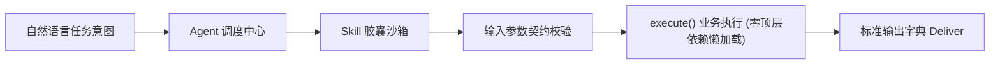

# 立体空间智能体系统 · 工业级技能开发规约 (AI Skill Developer Spec)

> **版本**：v1.0.0 (Industrial Grade)  
> **适用环境**：Litikj Agent Framework (<40MB 纯净微内核)  
> **目标人群**：AI 编程学员、Cursor / Antigravity / Claude Code 自主开发助手

---

## 一、 核心设计哲学：规范驱动技能工程 (Spec-Driven Skill Engineering)

在立体空间微内核框架中，**原子技能 (Atomic Skill)** 是数字化员工执行特定领域确定性计算的最小可交付单元。
我们拒绝“在空文件夹里写面条脚本”，严格遵循**微内核护栏规范**：



---

## 二、 技能胶囊物理目录结构

每个合规技能胶囊必须是一个物理独立的文件夹，放置于 `skills/custom/<skill_name>/`（自定义开发）或 `skills/official/<skill_name>/`（官方预置）：

```text
skills/custom/<skill_name>/
├── manifest.yaml          # 【强制】技能元数据、版本与 JSON Schema 参数契约
├── entry.py               # 【强制】继承 BaseSkill 的业务主逻辑与 setup(registry) 挂载
├── prompt.md              # 【强制】技能系统提示词与人设定位
├── README.md              # 【强制】中文使用文档与快速上手指令
└── tests/
    └── test_local.py      # 【强制】独立单元测试入口，直接对接 pytest
```

---

## 三、 四大首要铁律 (Iron Laws)

### 1. 零顶层重型依赖律 (SOP §4.3) - 【最高红线】
* **严禁在 `entry.py` 顶层导入非标准库**（如 `requests`, `torch`, `faster_whisper`, `PIL`, `numpy`, `playwright`, `cv2` 等）；
* 仅允许顶层导入：Python 标准库（`os`, `sys`, `json`, `time`, `pathlib`, `typing`, `re`, `hashlib`）与微内核基础契约（`core.contract.BaseSkill`, `core.registry.Registry`）；
* **所有重型第三方库必须在 `execute()` 方法内部懒加载 (`import ...`)**；
* **违规后果**：微内核动态扫描加载时会发生顶层 `ImportError` 崩溃，导致无法执行自检与自愈门禁。

### 2. 规范契约继承律
* 技能主类必须继承 `core.contract.BaseSkill`；
* 必须在文件末尾提供微内核挂载点函数：
  ```python
  def setup(registry: Registry):
      registry.register_skill(YourSkillClass())
  ```

### 3. 本地相对路径寻址律 (Zero Absolute Path)
* 严禁在代码中写死个人电脑的物理绝对路径（如 `G:\...` 或 `C:\Users\...`）；
* 凡需要静态参考图、模板或模型，必须放置于技能自身的 `assets/` 目录，并通过相对路径定位：
  ```python
  ASSETS_DIR = Path(__file__).resolve().parent / "assets"
  REF_IMAGE = ASSETS_DIR / "sample.jpg"
  ```

### 4. 交付必带测试律 (Self-Contained Testing)
* 技能目录下必须配备 `tests/test_local.py`；
* 学员或 AI 助手在开发完成后，必须运行 `pytest skills/custom/<skill_name>/tests/test_local.py -v` 确保全绿后方可交付。

---

## 四、 标准脚手架一键生成

框架内置工业级脚手架，无需手动从零创建文件：

```bash
# 一键生成标准技能模板
python run.py new skill <skill_name> -d "技能功能描述" -c "自媒体内容/通用工具"

# 立即运行自动化单测验证模板有效性
pytest skills/custom/<skill_name>/tests/test_local.py -v
```

---

## 五、 manifest.yaml 元数据契约规范

```yaml
id: "video_watermark_remover"
name: "视频智能无痕去水印"
display_name: "视频智能无痕去水印工具"
version: "1.0.0"
author: "学员昵称"
icon: "🪄"
category: "视频处理"
status: "stable"             # 状态: stable | experimental | deprecated
origin: "custom"             # 来源: custom | official | community
description: "使用开源算法检测并智能擦除视频台标与浮动水印"
tags: ["视频处理", "去水印", "自动化"]

inputs:
  - name: "video_path"
    type: "string"
    required: true
    desc: "待处理视频文件绝对路径"
  - name: "watermark_box"
    type: "list"
    required: false
    desc: "水印边界框坐标 [x1, y1, x2, y2]"

outputs:
  - name: "output_path"
    type: "string"
    desc: "处理完成后的无水印视频路径"
  - name: "elapsed_seconds"
    type: "float"
    desc: "处理耗时秒数"
```

---

## 六、 entry.py 标准模板范例

```python
# -*- coding: utf-8 -*-
import os
import sys
from pathlib import Path
from typing import Dict, Any

from core.contract import BaseSkill
from core.registry import Registry


class VideoWatermarkRemoverSkill(BaseSkill):
    def __init__(self):
        super().__init__(
            name="video_watermark_remover",
            display_name="视频智能无痕去水印工具",
            description="使用开源算法检测并智能擦除视频台标与浮动水印",
            version="1.0.0",
            author="本地开发者",
            icon="🪄",
            category="视频处理",
            origin="custom"
        )

    def execute(self, inputs: Dict[str, Any]) -> Dict[str, Any]:
        """核心业务逻辑 (遵守懒加载铁律)"""
        video_path = inputs.get("video_path")
        if not video_path or not Path(video_path).exists():
            raise FileNotFoundError(f"未找到目标视频: {video_path}")

        # 🛡️ 懒加载重型库
        # import cv2
        # import numpy as np

        # 处理产物
        return {
            "output_path": str(Path(video_path).with_name("cleaned_video.mp4")),
            "elapsed_seconds": 1.5
        }


def setup(registry: Registry):
    registry.register_skill(VideoWatermarkRemoverSkill())
```
