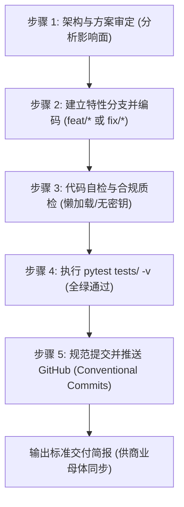

# 🛠️ Litikj Agent Framework · 开源技术研发标准作业程序 (DEVELOPER SOP)

> **版本**：v1.0.0 (工业级开源研发规范)  
> **适用工程**：`G:\litikj-agent-framework` (开源技术研发实验室)  
> **适用对象**：人类开发者、Antigravity AI Agent 及所有参与开源贡献的工程师。  
> **最高宗旨**：确保开源微内核（<40MB）绝对纯净、接口契约向下兼容、代码 100% 通过自动化测试回归，实现“高质量研发 ➔ 规范化交付 ➔ 商业仓平滑同步”。

---

## 一、 研发三大红线铁律 (The Iron Laws)

所有在开源仓进行的代码编写、修改或重构，必须把以下三大铁律作为不可逾越的红线：

### 铁律一：顶层零第三方重型依赖 (Zero Top-Level Third-Party Imports)
* **红线要求**：在 `core/`、`entry.py`、`tools/` 的模块顶层全局作用域，**严禁直接 `import` 任何非标准库的第三方重型依赖**（如 `requests`, `PIL`, `torch`, `playwright`, `faster_whisper` 等）；
* **原因**：微内核采用动态插件发现机制。如果顶层直接导入第三方库，在纯净微内核环境中加载时会触发 `ImportError`，导致插件或智能体在 Fail-Early 门禁运行前直接崩溃；
* **正确范式**：顶层仅允许导入 Python 原生标准库（`os`, `sys`, `json`, `pathlib`, `typing`, `re`, `hashlib` 等）和系统基座，**所有可选第三方库一律在具体方法内部按需懒加载 (Lazy Import)**。

### 铁律二：基类契约与向下兼容锁定 (Backward Compatibility)
* **红线要求**：对 `StandardAgent`、`PreflightItem`、`BaseGuard`、`TaskReporter` 等核心抽象基类的公共方法签名、返回值结构，**必须维持 100% 向下兼容**；
* **原因**：下游商业仓（`立体空间智能体系统`）及其挂载的大量商业员工深度依赖此基类，任何破坏性变更都会导致商业仓编译或运行时报错。

### 铁律三：自动化测试 100% 全绿门禁 (100% Tests Passed)
* **红线要求**：提交并推送到 GitHub 之前，必须在本地终端执行 `pytest tests/ -v`，**必须 100% 全绿（全部 Passed，0 Failed）**；
* **原因**：开源主分支（`main`）是全网开发者和商业母体的依赖之源，严禁带病提交。

---

## 二、 五步闭环标准研发工序 (5-Step Engineering Workflow)



### 步骤 1：需求对齐与方案审定
* 接收到研发指令后，AI 必须先定位相关核心模块；
* 向开发者简明阐述修改思路、涉及的文件列表与可能的影响面，杜绝盲目改动。

### 步骤 2：建立特性分支并编码
* **分支命名标准**：
  * Bug 修复：`git checkout -b fix/<short-name>`（例如 `fix/fastpath-timeout`）
  * 新功能研发：`git checkout -b feat/<short-name>`（例如 `feat/mcp-converter`）
* **编码约束**：
  * 编写或修改代码；
  * 保留原有注释与文档，所有新函数附带 Type Hints 与 Docstring；
  * 同步在 `tests/` 下补充或更新对应的单元测试。

### 步骤 3：代码静态合规自检
* 检查 `git status`，确保没有生成残留的临时文件、调试代码或缓存；
* 检查新引入的代码中是否存在未捕获的全局第三方模块导入；
* 检查配置中是否存在硬编码的生产密钥。

### 步骤 4：自动化回归测试门禁
在终端运行：
```powershell
pytest tests/ -v
```
* **合格指标**：测试套件 100% 通过（当前基线：100% Passed）；
* 若有任何测试失败，必须就地修复直至全绿方可推进。

### 步骤 5：规范化提交与推送到 GitHub
遵循 Conventional Commits 规范执行合并与推送：
```powershell
# 1. 规范提交
git add core/ desktop/ apps/ docs/ tests/
git commit -m "<type>(<scope>): <简明中文描述>"
# 常见 type: feat, fix, refactor, perf, test, docs, chore

# 2. 合并回主分支
git checkout main
git merge <feature-branch> --no-ff -m "merge: 合并特性分支 <feature-branch>"
git branch -d <feature-branch>

# 3. 推送至开源 GitHub 远程仓库
git push origin main
```

---

## 三、 标准交付简报规范 (Handover Card)

每次代码推送成功后，AI 必须向开发者输出统一的【交付简报】，作为下一步在商业仓执行同步的凭证：

```markdown
### 📦 Litikj Agent Framework · 研发交付简报
* **变更类型**：`feat(core)` / `fix(desktop)`
* **最新 Commit**：`<commit_hash>`
* **修改模块**：`<file1>`, `<file2>`
* **自动化测试**：`XX Passed, 0 Failed (100% 全绿)`
* **GitHub 状态**：已成功推送到 `origin/main`

👉 **下一步指引**：请切回【商业母体窗口】，发送 `@dual-repo-sync-manager 同步底座` 完成母体对齐！
```

---

## 四、 Antigravity AI 极简口令映射 (Short Triggers)

在 Antigravity 开源项目对话框中，支持通过以下极简指令唤醒本 SOP：

| 触发短语 | 触发动作 | AI 自动化行为 |
| :--- | :--- | :--- |
| `【研发】: <需求描述>`<br>*(或 "研发: <需求>")* | **启动研发任务** | 自动执行步骤 1~3：分析方案 ➔ 建特性分支 ➔ 编写代码与单测 ➔ 验证功能。 |
| `【交付】`<br>*(或 "交付并推送")* | **执行交付收尾** | 自动执行步骤 4~5：跑 `pytest` 全绿门禁 ➔ 规范提交 ➔ 合并 main ➔ 推送 GitHub ➔ 输出交付简报。 |
