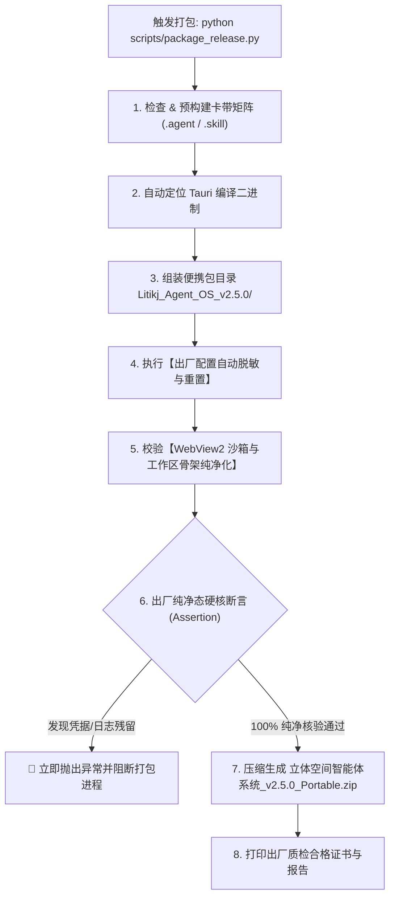

# 📦 【立体空间智能体系统】商业发售打包规范与出厂纯净态准则 (Packaging Guide)

> **最高效力声明**：本规范是立体空间智能体系统商业交付发售的核心工程铁律。任何开发者或 AI 助手在执行系统构建、发售包组装 (`scripts/package_release.py`) 或桌面端编译前，**必须无条件严格遵照本规范执行**。

---

## ⚡ 核心红线：出厂纯净态四大铁律 (Zero-Contamination Red Lines)

为彻底消灭发售交付中“解压后直接显示已激活”、“残留开发者测试对话”、“环境体积臃肿失控”以及“用户系统垃圾残留”等致命体验隐患，系统确立**出厂纯净态四大铁律**：

### 1. 凭据绝对脱敏律 (Zero-Credentials)
- **红线**：`configs/framework.yaml` 中的商业激活码 (`license_key`)、自定义大模型密钥 (`api_key`) 必须**出厂强制置空**；
- **交付要求**：用户初次开箱启动系统时，必须呈现干净的“未激活商业授权”引导状态，用户凭专属激活码自主激活。严禁任何开发者测试激活码或临时 Key 泄漏至发售包中。

### 2. 便携沙箱数据隔离律 (True-Portable Sandbox)
- **红线**：桌面端（Tauri / WebView2）**严禁使用 Windows 操作系统全局用户目录** (`%LOCALAPPDATA%\com.litikj.agentos`) 存储浏览器数据；
- **交付要求**：系统必须通过底层环境变量 `WEBVIEW2_USER_DATA_FOLDER` 将浏览器数据（LocalStorage、IndexedDB、Cookies、缓存）就地重定向至程序工作区沙箱目录 `workspace/data/webview/`；
- **收益**：
  1. **零污染**：解压即可运行，删除文件夹即彻底卸载，在用户系统注册表与 AppData 中不留一丝痕迹；
  2. **零泄漏**：开发机上测试生成的对话历史绝不会串读到新解压的便携包中；
  3. **真便携**：用户将便携包复制到 U 盘或换电脑运行，数据完全跟随工作区流转。

### 3. 历史对话与运行记录清零律 (Zero-Conversation Residual)
- **红线**：发售包中**严禁携带任何历史对话会话、临时运行日志或测试缓存**；
- **交付要求**：
  1. `workspace/logs/` 目录必须仅保留纯净骨架，严禁残留任何 `sidecar.log`、调试堆栈；
  2. `workspace/data/webview/` 出厂时必须为全新空目录；
  3. 智能体首屏对话流必须呈现 100% 纯净的欢迎卡片与常用指令网格，严禁残留任何 `[EXEC] status` 等历史开发测试指令。

### 4. 底座微内核纯净律 (Zero-Payload Base)
- **红线**：底座便携包 (`Portable.zip`) 体积必须维持极致小巧（~40MB 微内核），**严禁将尚未招募的智能体私有重型依赖库预先塞入发售包**；
- **交付要求**：
  1. `runtime/` 仅打包 Python 官方纯净内核与微内核基础依赖 (`yaml`, `psutil`, `PIL`)；
  2. 所有重型业务依赖（如 `faster-whisper`, `moviepy`, `playwright` 等）及权重模型，一律遵循**“按需招募、环境检测、一键自愈”**机制由用户在使用时自动热装配。

---

## 🛠️ 打包脚本自动化防护机制 (Script-Level Safeguards)

为防止人工疏忽，[`scripts/package_release.py`](file:///g:/立体空间智能体系统/scripts/package_release.py) 内建了**脚本级不可绕过的自动化防御管道**：



### 自动化防护清单：
1. **自动配置脱敏**：脚本自动检索临时目录中的 `configs/framework.yaml`，通过正则将 `license_key` 与 `api_key` 强制擦除为空字符串；
2. **根目录源头校验**：打包前自动检测主工程的 `configs/framework.yaml`，若包含非空激活码立即发出高亮警告并支持联动复位；
3. **工作区纯净化**：自动清理临时目录中的 `workspace/logs/*` 与 `workspace/data/webview/*`；
4. **硬核打包断言**：在执行 ZIP 压缩前，通过 YAML 解析器读取待打包配置，若 `license_key != ""`，直接中断构建并报错，杜绝任何带病交付。

---

## 📋 开发者标准打包操作指南 (SOP)

每次商业版本发布前，请按以下标准步骤执行：

### 第一步：全量单元测试与稳定性回归
在项目根目录运行：
```powershell
pytest tests/ -v
```
**合格标准**：所有测试用例 100% 通过（当前基线：123/123 Passed）。

### 第二步：编译前端与 Tauri 原生桌面端
进入桌面端目录执行编译：
```powershell
cd desktop
npm run build
cargo tauri build
cd ..
```
**合格标准**：`desktop/src-tauri/target/release/` 成功生成 `立体空间智能体系统.exe` 及 NSIS 安装包。

### 第三步：运行商业级打包与纯净化归档工具
在项目根目录运行：
```powershell
python scripts/package_release.py
```
**合格标准**：
- 控制台输出出厂质检清单，所有项目均打上 `[PASS]` 绿色标记；
- `release/` 目录下生成：
  - `立体空间智能体系统_v2.5.0_Portable.zip` (免安装绿色便携包)
  - `立体空间智能体系统_v2.5.0_Setup.exe` (Windows 官方安装包)

---

## 🔍 发布后验收核对清单 (Post-Flight Verification Checklist)

每次打包完成后，必须执行以下 4 项人工盲检：

| 验收项 | 操作步骤 | 预期合格现象 | 判定 |
| :--- | :--- | :--- | :--- |
| **1. 授权状态** | 解压 Portable.zip 到新的独立文件夹，双击运行 exe | 状态栏显示 **`未激活商业授权`**，点击弹出激活码输入框，无自动激活 | [ ] |
| **2. 会话清爽** | 进入工作台，查看全维调度哨兵 | 对话框为 **全新空态欢迎引导**，绝对无任何历史聊天记录 | [ ] |
| **3. 便携沙箱** | 启动后查看解压目录 `workspace/data/` | 自动生成独立的 `workspace/data/webview/`，关闭应用无外部残留 | [ ] |
| **4. 环境自愈** | 招募并切换到新智能体 | 准确识别未安装依赖，点击“一键安装环境”可正常下载并自愈 | [ ] |

---
**立体空间智能体系统 · 工业级交付品质保证**
